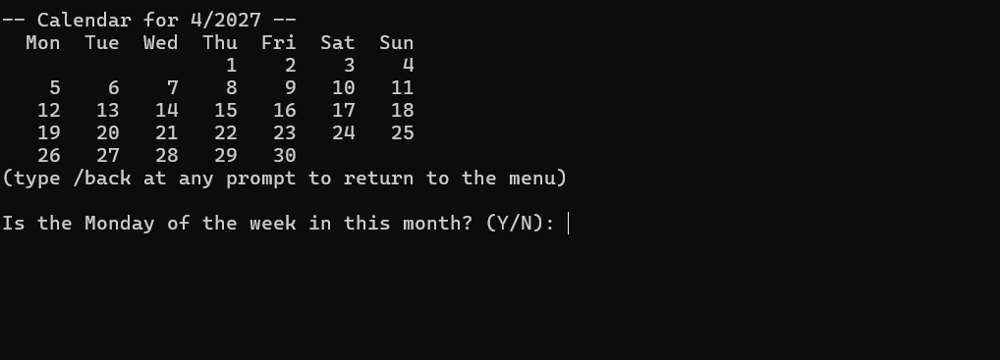
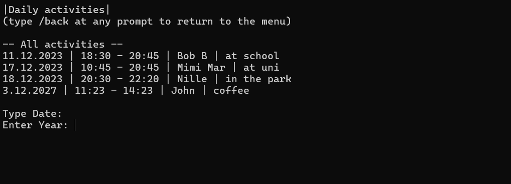

# Personal Calendar

Console calendar in C++ for planning meetings and activities. It checks for overlapping activities, finds free time slots and creates statistics for how busy a certain period is.

## Features

- Add an activity with a date, start and end time, a person to meet and a description
- An activity cannot overlap with an existing one and the program shows which activity is in the way
- Remove or change an activity, chosen from a numbered list
- Show all activities for a given day
- Search activities by a keyword in the person's name or the description
- Busyness statistics: the program counts the activities per day in a period (needs start and end date to be entered), sorts from the least to the most busy day and saves them to a file
- Find free time: for a chosen week, a daily time window and a length, list the free intervals in every day of the week
- Months can be entered as a number or a name (`3`, `mar`, `march`)
- Type `/back` at any prompt to return to the menu
- Activities are kept sorted by date and time and saved to a file after every change

## Example





## Building and running

Requires a compiler with C++17 support. The program clears the console with `cls`, so it is meant for Windows.

**Visual Studio:** open `PersonalCalendar.sln` and press `Ctrl+F5`.

**g++:** run these in the project folder:

```bash
g++ -std=c++17 src/*.cpp -o calendar.exe
.\calendar.exe
```
Run the program from the project folder, because it reads and writes its files in `data/`.

## Project structure

```
src/
    main.cpp            entry point
    Interface           main menu
    All_activities      loading, sorting, saving and checking activities for overlaps
    Activity            one activity: date, time, person and description
    Date, Time          input, validation and comparison of dates and times
    Calendar            printing a month and checking that a period is a whole week
    Add_activity    \
    Remove_activity |
    Change_activity | - inherit class for menu option
    Daily_activity  |
    Find_activity   |
    Busyness        |
    Find_time_slot  /
data/
    calendar.txt        the saved activities
```

## File formats

- `calendar.txt`: one activity per line: `day.month.year | HH:MM - HH:MM | person | description`
- `stats-<year>-<month>-<day>.txt`: created by the busyness statistics, one day per line with the number of activities

## Possible improvements

- Support recurring activities, for example every week on the same day and time. 
- Mark the days that already have activities in the printed calendar.